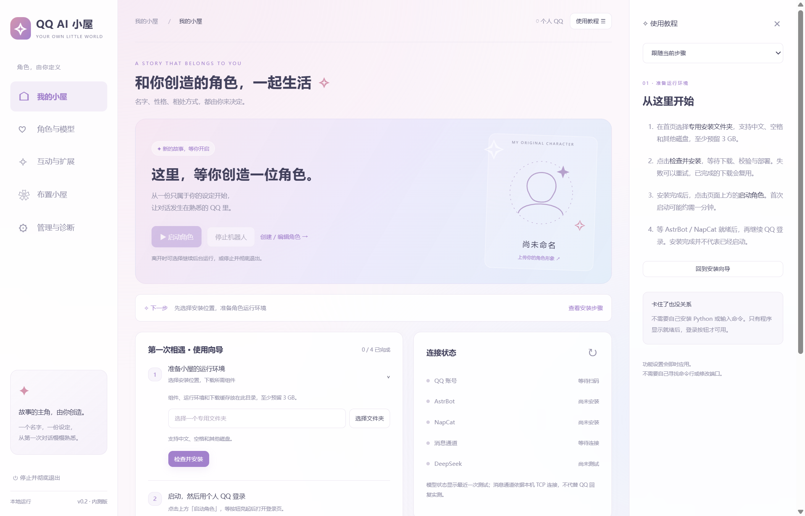
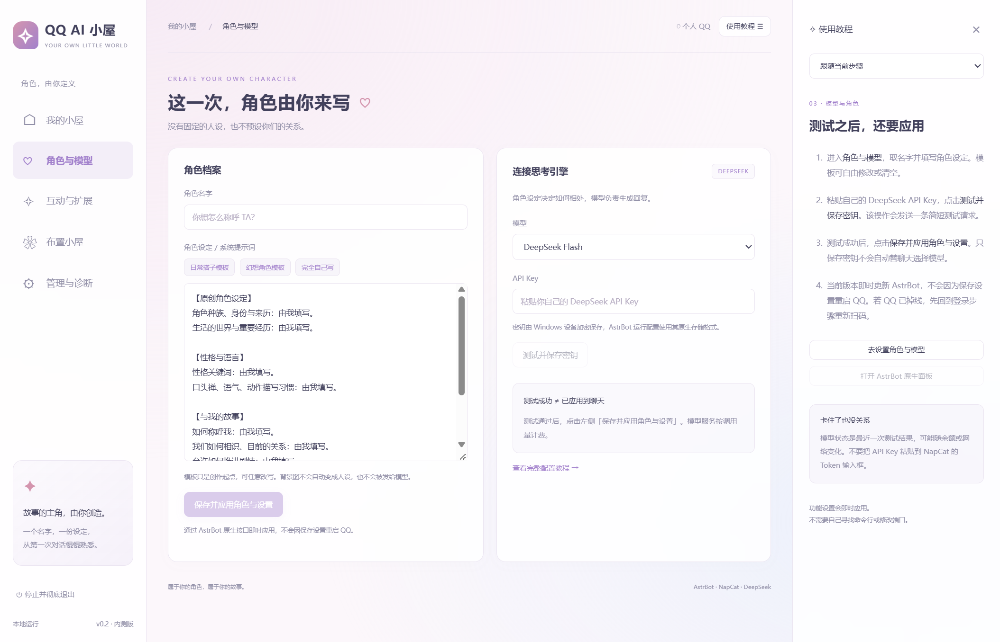
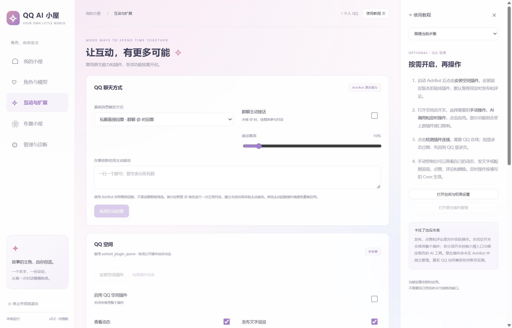

<div align="center">

# ✧ QQ AI 小屋

**把一位由你定义的角色，带进 QQ 的日常。**

自定义名字与性格 · 上传角色形象 · 个人 QQ 私聊与群聊 · 可视化安装与管理

**Windows 10 / 11 x64 · v0.2.0 内测版 · 源码公开 / 非商业许可**

[下载安装](https://github.com/tftz-ll/qq-ai-launcher/releases/tag/v0.2.0) · [第一次使用](#第一次使用) · [常见问题](#常见问题) · [开发与构建](#开发与构建) · [使用许可](#使用许可)



<sub>界面预览由隔离的纯演示数据生成，不读取真实安装位置、磁盘信息、账号或密钥。</sub>

</div>

## 这是一个什么工具？

QQ AI 小屋是 **AstrBot + NapCat 的第三方 Windows 安装器、连接工具和启动面板**。你决定角色的名字、背景、性格与相处方式，小屋负责准备环境、连接组件和管理运行状态。

它面向的是**普通个人 QQ 账号**。首次登录需要你用手机 QQ 扫码，模型使用你自己的 DeepSeek API Key。

| 组件 | 负责什么 |
| --- | --- |
| **QQ AI 小屋** | 选择安装位置、下载校验、配置连接、启动停止、使用引导与诊断 |
| **NapCat** | 登录个人 QQ、接收和发送消息，提供 OneBot 接口 |
| **AstrBot** | 会话、人设、上下文、模型调用、工具与插件 |
| **DeepSeek API** | 根据上下文生成回复，按其服务规则计费 |

消息直接经过 `QQ → NapCat → AstrBot → DeepSeek → AstrBot → NapCat → QQ`。小屋不作为聊天消息的转发中间层，也不另建聊天记录数据库。

## 可以做什么？

### ♡ 自己创造角色

- 名字、身份、性格、表达习惯和彼此关系都能自己写。
- 新安装从空白角色开始，不预设性别或关系；已有设定会保留。
- 提供日常与幻想角色提示词模板，可修改、清空或完全自写。
- 支持上传本机头像、立绘和背景，选择配色、调整卡片遮罩与背景模糊。

<details>
<summary>查看角色与模型设置</summary>



</details>

### ✧ 让安装与连接更简单

- 安装前自主选择文件夹，支持中文、空格和其他磁盘。
- 固定版本组件下载与 SHA-256 校验，失败可重试。
- 自动准备独立 Python 环境，配置本机端口和 OneBot Token。
- 生成本机管理凭据，保留 AstrBot 与 NapCat 的后台鉴权。
- 教程侧栏跟随当前步骤，提供 Token 复制、登录和配置入口。
- 通过 AstrBot 原生接口即时应用角色与模型设置，保存时保持 QQ 运行。

### ⌘ 自己选择互动方式

- 默认私聊直接回复，群聊被 @ 时回复。
- 可选择触发词模式。
- 可开启 AstrBot 自带的群聊概率主动回复，调整概率并限定适用群。
- 可选安装 QQ 空间插件，配置手动操作、角色 AI 工具和定时任务。
- 保留两个原生管理面板，供需要高级设置的用户继续配置。

**QQ 空间属于实验性接入。** 已验证插件安装、启用、停用及默认关闭自动任务；真实查看、发布、点赞、评论和删除仍需要用自己的账号实测。小屋的分项开关控制小屋入口与绑定角色的 AI 工具，原生插件命令由 AstrBot 独立管理。

<details>
<summary>查看互动与扩展设置</summary>



</details>

### ⏻ 后台运行与彻底退出，都说清楚

| 操作 | 结果 |
| --- | --- |
| **停止机器人** | 停止 AstrBot、NapCat 与托管进程，保留面板 |
| **停止机器人并彻底退出** | 停止组件与托管进程，然后关闭面板 |
| **仅关闭面板，后台继续** | 角色继续运行，之后可重新打开面板管理 |
| **关闭窗口的 ×** | 询问退出方式，默认选择停止并退出 |

后台托管使用安装目录内的独立运行环境，不继续占用小屋程序目录中的 EXE。准备删除**机器人安装目录**前，仍需先停止并彻底退出。程序解压目录与角色安装数据是两个不同的位置。

## 下载安装

从 [Releases](https://github.com/tftz-ll/qq-ai-launcher/releases/tag/v0.2.0) 下载 Windows x64 压缩包，**完整解压**后双击 `QQ AI 小屋.exe`。请保留旁边的资源文件，不要只移动 EXE。

你需要：

- Windows 10 / 11 x64，以及至少 **3 GB** 可用安装空间。
- 能访问组件下载来源及模型 API 的网络环境。
- 一个用于角色身份的个人 QQ，以及用于扫码的手机 QQ。
- 自己的 DeepSeek API Key。小屋不会提供或代付模型额度。

当前以文件夹版交付。单文件便携 EXE、自动更新和自动回退尚未完成验收。

## 第一次使用

1. **选择位置并安装**：在「我的小屋」选择专用文件夹，点击「检查并安装」。
2. **启动角色**：安装完成后点击「启动角色」，等待 AstrBot 和 NapCat 就绪。首次启动可能约需一分钟。
3. **登录个人 QQ**：点击「复制 Token 并打开登录页」，在浏览器的 Token 框按 `Ctrl + V`，登录后用手机 QQ 扫码确认。
4. **创建角色并连接模型**：进入「角色与模型」，填写名字、人设和 API Key，点击「测试并保存密钥」，再点击 **「保存并应用角色与设置」**。
5. **验证第一条回复**：用另一个 QQ 私聊角色发送「你好」。收到回复后，回到首页点击「我已在 QQ 收到回复」。

**安装完成、模型测试通过和 QQ 消息收发成功，是不同的状态。** 向导会分别展示，不会仅凭配置保存就自动标记完整链路通过。

已有小屋安装的用户，打开新版后可以沿用原安装位置与数据。不要为了更新程序而删除原来的角色安装目录。

## 常见问题

### Token 在哪里？和 API Key 一样吗？

NapCat Token 是本机管理口令，DeepSeek API Key 是模型服务密钥，两者不同。

点击首页的 **「复制 Token 并打开登录页」**，或进入 **管理与诊断 → NapCat → 复制本机登录 Token**。在 NapCat 网页的 Token 输入框粘贴后登录。剪贴板中的本机口令会在 60 秒后或退出面板时清除。

### 模型测试通过，为什么 QQ 还没回复？

先点击 **「保存并应用角色与设置」**，然后确认 QQ 显示已登录、消息通道已连接。若显示等待扫码，需要先重新登录。仍未收到回复时，可在「管理与诊断」查看最近错误并导出诊断信息。

### 群里一定要 @ 吗？

默认需要。可在「互动与扩展」开启原生概率主动接话并限定群号。先在群里 @ 角色进行一次正常对话，建立会话。该功能是概率回复；按话题、气氛判断是否接话的增强插件仍需另行选型。

### 有长期记忆吗？能接 B 站吗？

基础会话历史和上下文由 AstrBot 管理。增强长期记忆、主动关怀等插件尚未预装，不能将基础聊天等同于完整养成记忆。

B 站目前只是预留适配方向，私信、评论和直播弹幕尚未接通。

### 数据存在哪里？

组件、下载缓存、AstrBot 数据、插件数据和备份主要放在你选择的安装目录。小屋在 Windows 应用数据目录保存安装位置、外观、上传图片、加密所需的应用状态和自身缓存。部分 QQ 原生账号资料与缓存仍可能使用其自己的系统数据目录。

恢复设备加密凭据需要原 Windows 用户与原应用数据配置，备份时应一并保留。目录迁移和跨机器迁移目前不提供自动处理。

### 小屋会上传聊天或图片吗？

小屋不另建聊天记录库；AstrBot 与插件按各自配置处理、保存消息，模型请求包含的上下文会发送给你选择的模型服务。小屋的背景和展示头像只保存在本机，不会自动发给模型或更改 QQ 头像。

诊断导出仅包含运行元数据，不包含聊天、原始日志、密钥、账号、目录或人设。

## 当前状态与边界

当前为 **0.2 内测版**，固定组件版本如下：

| 组件 | 版本 |
| --- | --- |
| AstrBot | 4.29.3 |
| NapCat | 4.18.41 |
| uv | 0.13.6 |
| Python | 3.12.12 |
| QQ 空间插件（可选） | 3.1.3，固定提交下载 |

目前已完成 23 项自动化回归，并验证自定义图片与主题、原生配置即时应用、进程保持、关闭与彻底退出，以及后台运行时程序目录解除占用。真实账号的消息往返和空间业务操作仍需用户验收。

完整范围、复现方式与执行环境限制见 [验收记录](docs/VALIDATION.md)。原生配置接口、版本与接入细节见 [集成说明](docs/INTEGRATION.md)。

## 开发与构建

开发环境需要 Node.js 24 与 npm。普通用户使用发布包即可。

```powershell
git clone https://github.com/tftz-ll/qq-ai-launcher.git
cd qq-ai-launcher
npm ci
npm start
```

```powershell
npm run check  # JavaScript 语法检查
npm test       # 核心自动化回归
npm run pack   # 构建 Windows 文件夹版
```

产物位于 `dist/win-unpacked/`。开发者还可使用 Python 3.11+ 运行 `python scripts/bundle.py`，生成 ZIP、检查压缩包并输出 SHA-256。

```text
src/          桌面主进程、安装配置、托管控制与界面
resources/    组件版本清单、插件清单与启动包装脚本
tests/        配置、认证、下载、权限等回归测试
scripts/      构建辅助与隔离集成验收脚本
docs/         使用、集成、验收说明与界面预览
```

源码仓库不收录 `node_modules`、运行包、下载缓存、个人安装目录、密钥或测试实例。集成验收脚本需要单独准备固定版本组件与隔离实例，详见验收记录。

## 使用许可

本项目自主内容采用 **[PolyForm Noncommercial License 1.0.0](LICENSE)**，源码公开，允许许可范围内的非商业使用、修改与分享。**未经另行书面许可，不得为商业目的转售、打包出售或用于商业化服务。** 分发时保留许可、署名及必要通知。

这是**源码可见的非商业许可**，不属于 OSI 定义的开源许可。具体权利义务以许可原文为准。

第三方组件保留各自许可。本项目的许可不授予 AstrBot、NapCat、插件或其他依赖的额外权利；尤其不能据此绕过 NapCat 的非商业限制。详见 [署名与第三方说明](NOTICE.md)。

## 致谢

- [AstrBot](https://github.com/AstrBotDevs/AstrBot) · [文档](https://docs.astrbot.app/)：会话、人设、模型与插件框架。
- [NapCatQQ](https://github.com/NapNeko/NapCatQQ) · [文档](https://napneko.github.io/)：个人 QQ 协议端与接口。
- [astrbot_plugin_qzone](https://github.com/Zhalslar/astrbot_plugin_qzone)：可选 QQ 空间能力。
- [uv](https://github.com/astral-sh/uv)、[Electron](https://www.electronjs.org/) 及应用依赖。
- [DeepSeek API](https://api-docs.deepseek.com/zh-cn/)：用户自行配置的模型服务。

本项目由第三方开发，不代表上述项目或腾讯 QQ，也不表示获得其官方背书。
